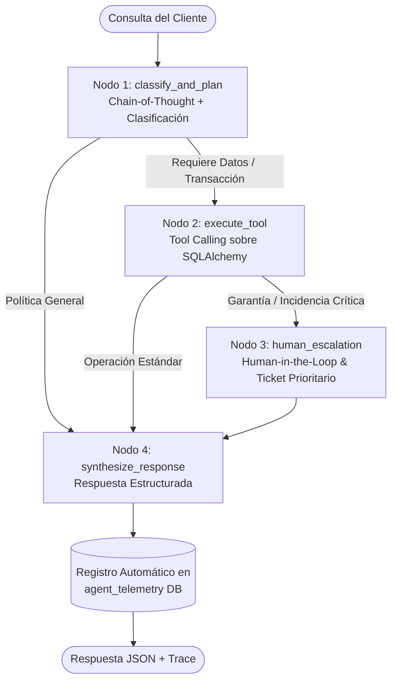

# 🤖 Enterprise Operations AI Agent & Real-Time Telemetry


Agente de IA autónomo diseñado para la **optimización de procesos postventa, logística y control de inventario en E-Commerce**. Construido bajo principios de arquitectura limpia, orquestación basada en grafos de estado con **LangGraph**, integración con **Google Gemini 3.8 Flash (`google-genai`)** y un **Dashboard de Telemetría en Tiempo Real** que monitorea latencia, tasa de error, escalamiento humano y volumen de llamadas a la API.

---

## 🏗️ Arquitectura del Grafo de Estados (LangGraph)



---

## ✨ Capacidades Principales

1. **Orquestación Autónoma con LangGraph (`StateGraph`)**:
   - Flujo determinista y auditable con pasos de razonamiento **Chain-of-Thought** explícitos.
   - Enrutamiento condicional para lectura de pedidos (`get_order_details`), consulta de stock (`check_product_inventory`), actualización segura de dirección (`update_shipping_address`) y generación de tickets (`create_return_or_support_ticket`).
2. **Validación de Reglas de Negocio Transaccionales**:
   - El agente verifica automáticamente el estado logístico antes de modificar una orden: permite cambios de dirección en pedidos `PENDING` o `PROCESSING`, pero bloquea modificaciones automáticas si el pedido ya está `IN_TRANSIT` o `DELIVERED`.
3. **Escalamiento Human-in-the-Loop**:
   - Ante reclamos de garantía, productos dañados o incidencias de facturación, el grafo transiciona por el nodo `human_escalation`, genera un ticket `HIGH/CRITICAL` y alerta al equipo supervisor.
4. **Dashboard Interactivo de Monitoreo en Tiempo Real**:
   - Seguimiento en vivo de **latencia promedio (ms)**, **tasa de error (%)**, **tasa de escalamiento (%)**, **consumo de tokens** y distribución de llamadas por intención operativa.

---

## 📂 Estructura del Proyecto

```text
enterprise-operations-agent/
├── docker-compose.yml          # Orquestación de PostgreSQL + FastAPI
├── requirements.txt            # Dependencias del proyecto
├── .env.example                # Plantilla de variables de entorno
├── src/
│   ├── agent/
│   │   ├── state.py            # Definición de OperationsAgentState (TypedDict)
│   │   ├── prompts.py          # System instructions y Chain-of-Thought
│   │   ├── nodes.py            # Nodos del grafo e integración con Gemini 3.8 Flash
│   │   └── graph.py            # Compilación del StateGraph y telemetría automática
│   ├── tools/
│   │   └── ecommerce_tools.py  # Herramientas SQL y declaraciones de funciones Gemini
│   ├── database/
│   │   ├── models.py           # Modelos ORM (Customer, Product, Order, SupportTicket, AgentTelemetry)
│   │   ├── connection.py       # Conexión dual SQLite (instantáneo) / PostgreSQL (producción)
│   │   └── seed.py             # Datos semilla realistas de E-Commerce en Perú
│   ├── api/
│   │   ├── main.py             # Servidor REST FastAPI (/api/v1/chat, /api/v1/metrics, etc.)
│   │   └── schemas.py          # Esquemas de validación Pydantic
│   └── monitoring/
│       ├── telemetry.py        # Cálculo de KPIs de observabilidad en tiempo real
│       └── dashboard.py        # Dashboard interactivo en Streamlit + Plotly
└── tests/
    └── test_agent_flow.py      # Suite de pruebas automatizadas con Pytest
```

---

## 🚀 Ejecución Rápida (Local)

### 1. Instalar dependencias
```bash
pip install -r requirements.txt
```

### 2. Configurar variables de entorno (Opcional para modo Demo, recomendado para Gemini en vivo)
Copia `.env.example` a `.env` y coloca tu llave de [Google AI Studio](https://aistudio.google.com/apikey):
```env
GEMINI_API_KEY=tu_api_key_aqui
GEMINI_MODEL=gemini-3.8-flash
DATABASE_URL=sqlite:///./enterprise_ops.db
```
*(El sistema incluye continuidad operativa automática: funciona al instante con datos reales de SQLite incluso antes de configurar la llave API).*

### 3. Lanzar el Dashboard Interactivo + Simulador del Agente
```bash
streamlit run src/monitoring/dashboard.py
```

### 4. Lanzar la API REST (FastAPI + Swagger UI)
```bash
uvicorn src.api.main:app --reload --port 8000
```
- Documentación interactiva OpenAPI: `http://localhost:8000/docs`
- Métricas en tiempo real: `http://localhost:8000/api/v1/metrics`

### 5. Ejecutar pruebas automatizadas
```bash
pytest -v
```

---

## 👤 Autor
**Joseph Pajuelo Cárdenas**  
Ingeniería de Sistemas e Informática (UTP) | AI Development & Business Intelligence  
[LinkedIn](https://linkedin.com/in/josephpajuelo) • [GitHub](https://github.com/Joseph-Pajuelo)
